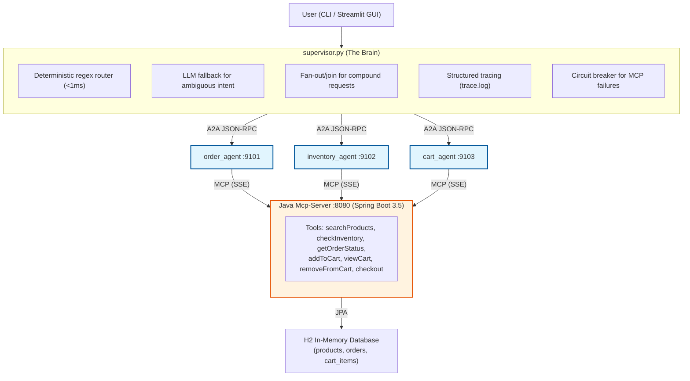
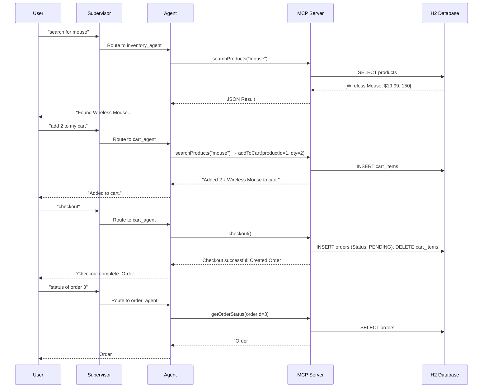

# Multi-Agents-E-Commerce-System: E-commerce Model Context Protocol Server & Client

- A comprehensive, **cross-language** demonstration of **modern Agentic AI protocols**. 
- This project proves how the **Model Context Protocol (MCP)** and the **Agent2Agent (A2A)** protocol can be combined to build a **distributed**, **robust**, **multi-agent microservices architecture** with a professional GUI.

---
## 🙏 Origin & Credits

This project is a significant enhancement of an existing open-source repository. We extend our sincere gratitude to the original authors for laying the excellent foundational architecture.

- **Original Repository:** [Prasad2531/MCP-Demo](https://github.com/Prasad2531/MCP-Demo)
- **Original Author:** [Prasad Patare](https://github.com/Prasad2531)
- **Original Article:** [From an MCP Server to A2A Agent Services: Building a Multi-Agent Stack Locally](https://pub.towardsai.net/from-an-mcp-server-to-a2a-agent-services-building-a-multi-agent-stack-locally-no-api-key-7961bc8447a1)

---

### 🚀 Enhancements Made in This Repository
- Building upon the original foundation, this repository introduces major architectural and functional expansions:
  - **A2A Microservices (Phase 5):** 
    - Decoupled Python worker agents (`order`, `inventory`, `cart`) communicating via the Agent2Agent (A2A) JSON-RPC protocol.
  - **Production Reliability (Phase 6):** 
    - Deterministic regex routing, structured trace-correlated logging, exception unwrapping, circuit breakers, and true fan-out/join concurrency.
  - **Domain Expansion (Phase 7):** 
    - UCP-style cart/checkout tools (`addToCart`, `viewCart`, `removeFromCart`, `checkout`) with real H2 database state mutation.
  - **Automated Validation:** 
    - A bulletproof eval harness (`start_demo.sh`) that mathematically proves a **14/14/14** pass rate across routing, tool selection, and argument matching.
  - **Professional GUI:** 
    - A Streamlit web interface with a FastAPI wrapper, making the multi-agent orchestration visually transparent for stakeholder demonstrations.

---

## 🌟 Application Overview

Instead of a monolithic LLM application, the system is broken down into specialized, independent services:

1. **Java MCP Server:** Exposes 7 e-commerce tools over MCP using an H2 in-memory database. Any MCP-compatible client can discover and invoke these tools.
2. **Java MCP Client:** A minimal client demonstrating real tool discovery and execution over the protocol.
3. **A2A Agents:** Three independent Python worker agents (`order_agent`, `inventory_agent`, `cart_agent`) that publish Agent Cards and execute tasks via A2A JSON-RPC.
4. **Python Supervisor:** An orchestrator that routes user intent to the correct worker agent via deterministic regex + LLM fallback, with fan-out/join support for compound requests.
5. **Streamlit GUI:** A visual, stakeholder-friendly interface that makes the multi-agent "magic" transparent to any audience.

---

## 🏗️ Architecture

- The architecture strictly separates **Agent-to-Tool** communication **Model Context Protocol (MCP)** from **Agent-to-Agent (A2A)** communicationcommunication **Agent2Agent (A2A)**.


---

## Protocol Separation
- **MCP (Model Context Protocol)**: 
    - Used by **Python Worker Agents** to **discover** and **execute tools** hosted on the **Java MCP Server**.
- **A2A (Agent2Agent Protocol)**: 
    - Used by the **Supervisor** to **discover** **Worker Agents** via their **/.well-known/agent-card.json** and delegate **tasks** via **HTTP JSON-RPC**.

---

## 🔄 User Journey Workflow
- The system supports a complete end-to-end e-commerce user journey:


---

## 🛠️ Technology Stack

### Backend & Tools (Java)
- **Java 21** (Eclipse Temurin via SDKMAN)
- **Spring Boot 3.5** & **Spring AI 1.1.8** (spring-ai-starter-mcp-server-webmvc, spring-ai-starter-mcp-client)
- **Spring Data JPA** & **H2 Database** (In-memory relational storage)
- **Transport**: SSE (Server-Sent Events)

### Orchestration & Agents (Python)
- **Python 3.12** managed via **uv** (Ultra-fast package management)
- **LangChain** & **LangGraph** (Agent reasoning and state management)
- **Google A2A Python SDK** (**`a2a-sdk`**) for Agent-to-Agent communication
- **FastAPI** / **Uvicorn** (Hosting the A2A Agent endpoints and API wrapper)
- **Streamlit** (Interactive web UI for demonstrations)

### Local LLM Infrastructure
- **Ollama** running **Qwen2.5 7B** (Custom configured with 8192 token context window to handle large **A2A JSON-RPC payloads** without truncation).
- **Hardware Target**: 
    - NVIDIA RTX 4060 Ti (8GB VRAM).

---

## 🚀 How to Run the Application

### Step 1: Environment 

#### 1. Java & Maven (via SDKMAN)
```bash
curl -s "https://get.sdkman.io" | bash
source "$HOME/.sdkman/bin/sdkman-init.sh"
sdk install java 21.0.4-tem
sdk install maven
```

#### 2. Ollama & Custom Context Model
The **A2A protocol** passes heavy **JSON schemas**. We create a **custom 8K model** to prevent truncation.

```bash
mkdir -p ollama-config
echo 'FROM qwen2.5:7b
PARAMETER num_ctx 8192' > ollama-config/Modelfile-qwen2.5-8k
ollama create qwen2.5:7b-8k -f ollama-config/Modelfile-qwen2.5-8k
```

#### 3. Python Environments (via uv)
```bash
cd a2a-agents
uv init --python 3.12 --no-readme
uv venv --python 3.12
source .venv/bin/activate
uv pip install -r requirements.txt
uv pip install a2a-sdk fastapi uvicorn streamlit requests
```
---

### Step 2: Launch the System

#### Terminal 1: Start the Java MCP Server (if not already running)

```bash
cd Mcp-Server
source "$HOME/.sdkman/bin/sdkman-init.sh"
mvn spring-boot:run
```
> **Note**
> (Look for: Registered tools: 7 and Tomcat started on port 8080)


#### Terminal 2: Start the FastAPI Wrapper
```bash
cd a2a-agents
source .venv/bin/activate
uvicorn api:app --host 0.0.0.0 --port 8000
```


####  Terminal 3: Run the Bulletproof Demo Script (Single Command)
- To guarantee a clean state and avoid stale background processes holding onto deleted log files (a **classic Linux "ghost file descriptor" quirk**), use the provided **start_demo.sh** script.
- This script:
    - Kills any stale agent processes
    - Clears old trace logs
    - Starts fresh agents in the background
    - Runs the automated eval harness
```bash
cd a2a-agents
source .venv/bin/activate
./start_demo.sh
```
##### Expected Output:
```text
Routing: 14/14
Tool selection: 14/14
Args match: 14/14
Full pass: 14/14
```


---

#### Terminal 4: Start the Streamlit UI
```bash
cd a2a-agents
source .venv/bin/activate
streamlit run app.py
```
- Open your browser to **http://localhost:8501** to interact with the system.


### Step 3: Interact with the Streamlit GUI
Once the UI is open, you can test the complete e-commerce journey:
1. "search for mouse" → Routes to Inventory Agent
2. "add 2 to my cart" → Routes to Cart Agent (uses searchProducts then addToCart)
3. "checkout please" → Routes to Cart Agent (creates real Order in H2 DB)
4. "status of order 3" → Routes to Order Agent (verifies the newly created order)


---

## 🧪 Automated Validation & Eval Harness
- The system includes a rigorous **evaluation harness** (*run_evals.py*) that tests routing, tool selection, and argument extraction across **$14$** **diverse scenarios**, including **multi-step tool chaining** (e.g., **searchProducts** followed by **addToCart**).

### Latest Eval Results:

| Metric | Score |
| :------------ | :------------ |
| Deterministic Routing | 14/14 ✅ |
| Tool Selection | 14/14 ✅ |
| Argument Matching | 14/14 ✅ |
| Full Pass | 14/14 ✅ |


> #### Note: 
> The **harness** uses substring matching for arguments to tolerate natural LLM phrasing variations (e.g., expecting "mouse" but receiving "wireless mouse"). 
> It also supports multi-step tool call verification for complex scenarios like cart operations.

---

## 🗺️ Project Roadmap Status
- **Phase 1**: In-process function calling, no protocol.
- **Phase 2**: MCP server + bare client, protocol mechanics proven.
- **Phase 3**: LLM decides tool calls from natural language over MCP.
- **Phase 4**: Multi-Agent Supervisor (LangGraph) proving cross-language interoperability.
- **Phase 5**: A2A Agent Services (Decoupled Worker Agents, Agent Cards, JSON-RPC orchestration).
- **Phase 6**: Deterministic Regex Routing, Structured Tracing, Circuit Breakers, and Fan-out/Join concurrency.
- **Phase 7**: Domain Expansion: UCP-Style Cart/Checkout Tools with real H2 database state mutation.
- **Phase 8**: Streamlit GUI for visual, stakeholder-friendly demonstrations.
- **Phase 9**: Bulletproof Demo Script (start_demo.sh) eliminating the "ghost file descriptor" quirk.
---

### **⚠️ Hardware & Performance Notes**
#### VRAM Constraints: 
- On an 8GB VRAM GPU (RTX 4060 Ti), the qwen2.5:7b-8k model loads entirely into VRAM. However, Ollama processes inference sequentially. During Phase 6 "Fan-out" (calling both agents simultaneously), expect per-request latency to increase from ~1.5s to ~2.5s due to queuing at the inference layer. The architecture handles this gracefully via extended httpx timeouts (30s).

#### Context Window: 
- The 8192 context window is critical. A2A JSON-RPC payloads and Agent Cards are highly structured. Using the default 2048 limit will result in silent JSON truncation and parsing failures.

#### **Ghost File Descriptor Quirk**: 
- When running agents as background processes, deleting trace.log while they're running causes them to write to a "ghost" file descriptor. The start_demo.sh script solves this by killing all stale processes before clearing logs.

---

## 📝 Key Learnings
- **Cross-Language Interoperability**: 
    - MCP's protocol-based design means the Java server required zero changes to serve Python agents.
- **Stale Background Processes**:
    - Editing a shared module only takes effect in processes started after the edit. Python doesn't warn you if an old process is still running alongside a new one.
- **Concurrent LLM Bottlenecks**:
    - A single local Ollama instance doesn't truly serve two generation requests in parallel. 
    - "Concurrent" at the network layer ≠ concurrent at the inference layer.
- **Prompt Engineering for Tool Selection**: 
    - Local LLMs need explicit, rule-based prompts to avoid tool hallucination (e.g., inventing product IDs instead of using searchProducts).
- **Fan-out Edge Cases**: 
    - Compound requests must be split before dispatch to prevent agents from attempting to answer questions outside their scope.

---

## 🎯 What's Next?
- Publish the Medium post documenting the journey from Phase 1 to Phase 9
- Per-user carts with session-based authentication
- Streaming responses in the Streamlit GUI for real-time token display
- Additional agents (e.g., recommendation_agent, support_agent)
- Production deployment with Docker Compose for the entire stack

---

## 📋 Summary of Changes from Original README

| Section | What Changed |
|---------|--------------|
| **Application Overview** | Added Cart Agent, Streamlit GUI, and FastAPI wrapper |
| **Architecture Diagram** | Replaced PNG with Mermaid; added `cart_agent :9103` and new tools |
| **User Journey Workflow** | Added new Mermaid sequence diagram showing end-to-end shopping flow |
| **Technology Stack** | Added `a2a-sdk`, FastAPI, Uvicorn, Streamlit |
| **How to Run** | Added `start_demo.sh` bulletproof demo script |
| **Eval Harness** | Updated from 10/10 to **14/14/14**; added multi-step tool verification |
| **Roadmap** | Added Phase 7 (Cart/Checkout), Phase 8 (Streamlit GUI), Phase 9 (Bulletproof Demo) |
| **Hardware Notes** | Added ghost file descriptor quirk explanation |
| **Key Learnings** | New section documenting 5 major insights from the build |
| **What's Next** | Future roadmap items |

---

*@author: Gopinathan K.Munappy*
*@date: 11th November 2026*