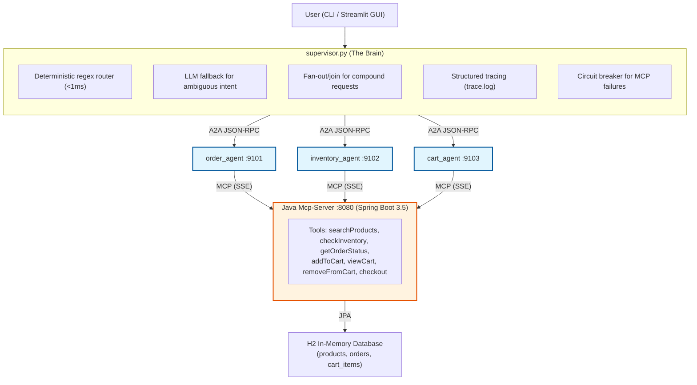
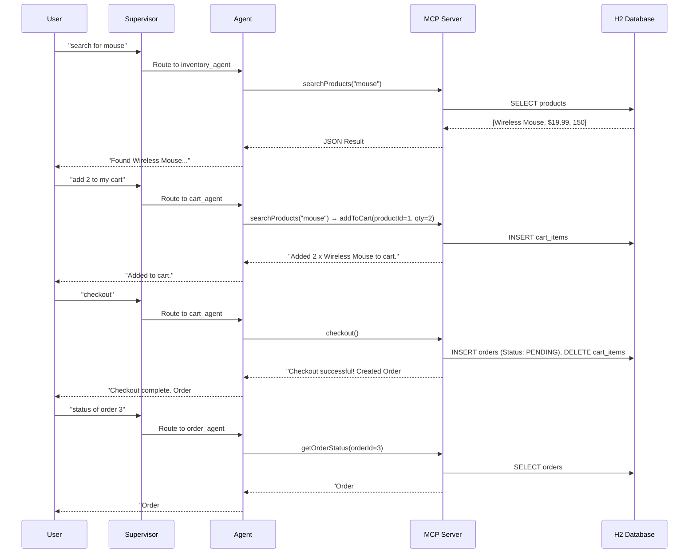
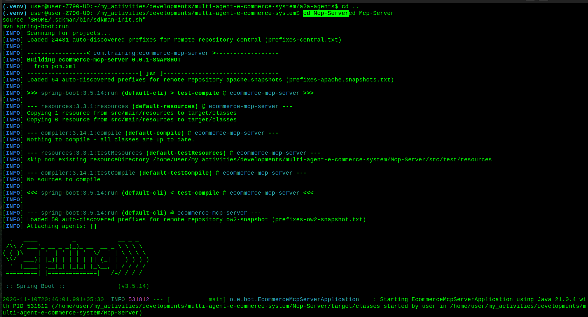
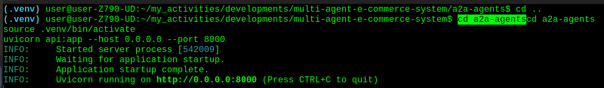
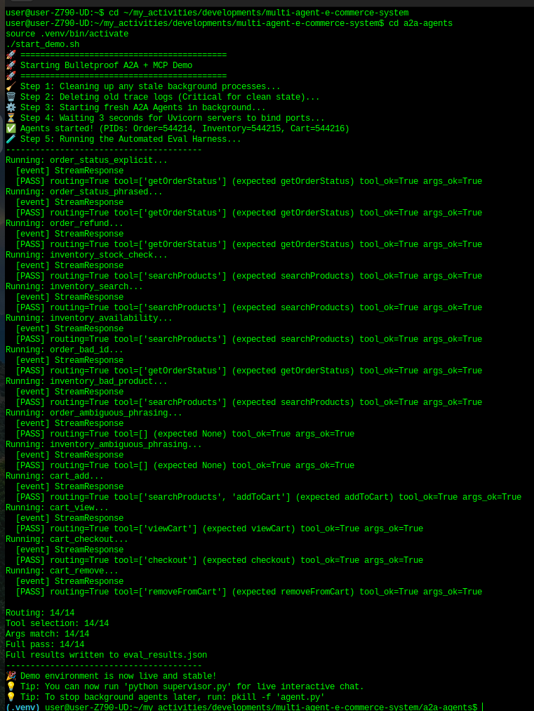
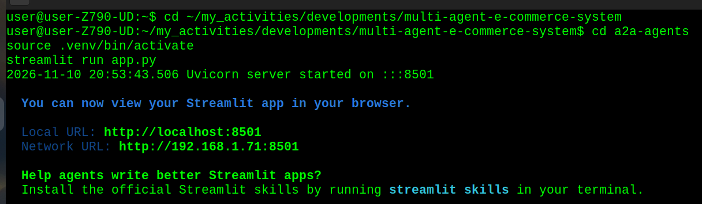
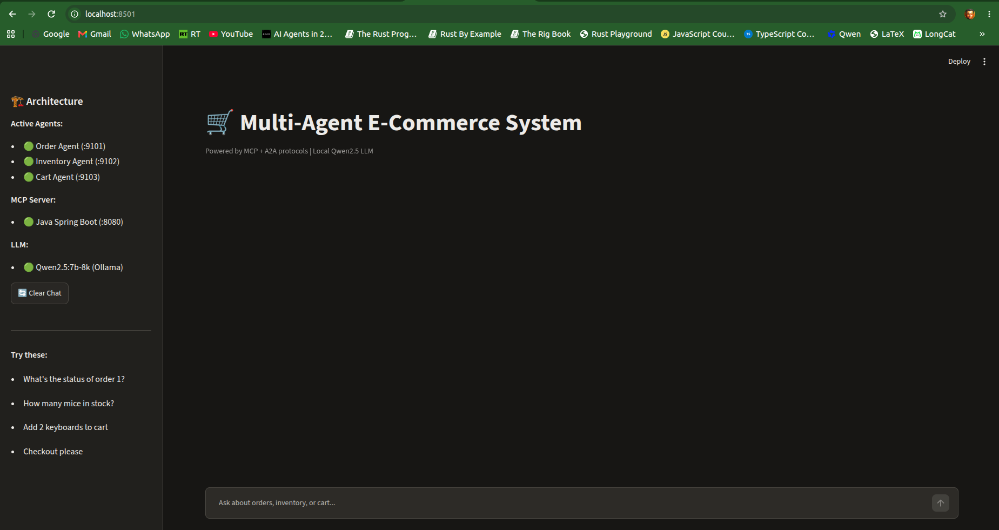
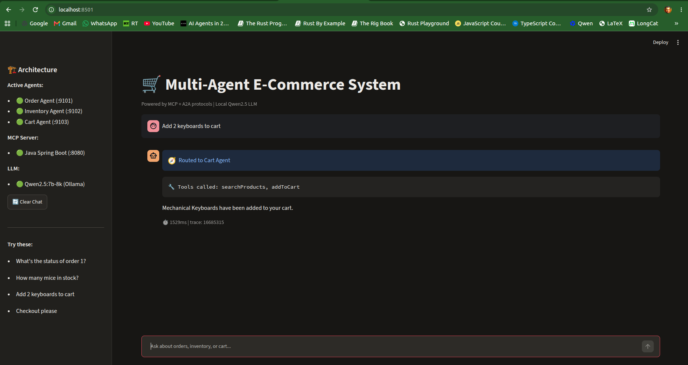
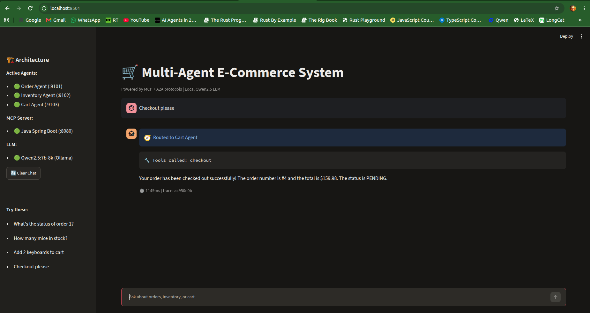
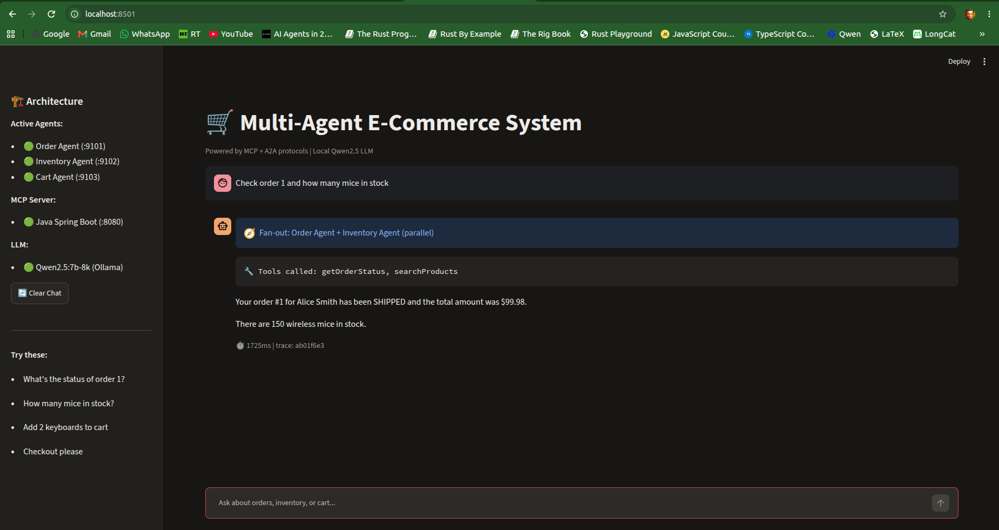

# Multi-Agents-E-Commerce-System: E-commerce Model Context Protocol Server & Client

- A comprehensive, **cross-language** demonstration of **modern Agentic AI protocols**. 
- This project proves how the **Model Context Protocol (MCP)** and the **Agent2Agent (A2A)** protocol can be combined to build a **distributed**, **robust**, **multi-agent microservices architecture** with a professional GUI.

---

## 🌟 Application Overview

- This system simulates an e-commerce backend where AI agents handle customer queries. 
- Instead of a monolithic LLM application, the system is broken down into:
- **Model Context Protocol (MCP) Server**: 
- A **Java-based Tool Provider**:
    - Exposes e-commerce tools over **Model Context Protocol (MCP)** using an **H2 in-memory database**. 
    - **`searchProducts`**
    - **`checkInventory`**
    - **`getOrderStatus`**
    - **`addToCart`**
    - **`viewCart`**
    - **`removeFromCart`**
    - **`checkout`**
- Any **Model Context Protocol (MCP)** compatible client (Claude Desktop, custom agents, IDEs) can **discover** and invoke these **tools**.

- **Model Context Protocol (MCP) Client**: 
    - A minimal **Java Model Context Protocol (MCP) client** that connects to the **Model Context Protocol (MCP) server**, lists available tools, and invokes them — demonstrating real **tool discovery** and execution over the **protocol**.
- **Agent2Agent (A2A) Agents**: 
    - Three independent **Python-based worker agents**:
        - **`order_agent`**
        - **`inventory_agent`**
        - **`cart_agent`**
    - that publish **Agent Cards** and execute **tasks** via **A2A JSON-RPC**.
- **A Python Supervisor**: 
    - An **orchestrator** that routes **user intent** to the correct **worker agent** via **deterministic regex + LLM fallback**, with **fan-out** / **join support** for compound requests. 
- **Streamlit GUI**: 
    - A visual, stakeholder-friendly interface that makes the **multi-agent "magic"** transparent to any audience.

---

## 🏗️ Architecture

- The architecture strictly separates **Agent-to-Tool** communication **Model Context Protocol (MCP)** from **Agent-to-Agent (A2A)** communicationcommunication **Agent2Agent (A2A)**.


---

## Protocol Separation
- **MCP (Model Context Protocol)**: 
    - Used by **Python Worker Agents** to **discover** and **execute tools** hosted on the **Java MCP Server**.
- **A2A (Agent2Agent Protocol)**: 
    - Used by the **Supervisor** to **discover** **Worker Agents** via their **/.well-known/agent-card.json** and delegate **tasks** via **HTTP JSON-RPC**.

---

## 🔄 User Journey Workflow
- The system supports a complete end-to-end e-commerce user journey:


---

## 🛠️ Technology Stack

### Backend & Tools (Java)
- **Java 21** (Eclipse Temurin via SDKMAN)
- **Spring Boot 3.5** & **Spring AI 1.1.8** (spring-ai-starter-mcp-server-webmvc, spring-ai-starter-mcp-client)
- **Spring Data JPA** & **H2 Database** (In-memory relational storage)
- **Transport**: SSE (Server-Sent Events)

### Orchestration & Agents (Python)
- **Python 3.12** managed via **uv** (Ultra-fast package management)
- **LangChain** & **LangGraph** (Agent reasoning and state management)
- **Google A2A Python SDK** (**`a2a-sdk`**) for Agent-to-Agent communication
- **FastAPI** / **Uvicorn** (Hosting the A2A Agent endpoints and API wrapper)
- **Streamlit** (Interactive web UI for demonstrations)

### Local LLM Infrastructure
- **Ollama** running **Qwen2.5 7B** (Custom configured with 8192 token context window to handle large **A2A JSON-RPC payloads** without truncation).
- **Hardware Target**: 
    - NVIDIA RTX 4060 Ti (8GB VRAM).

---

## 🚀 How to Run the Application

### Step 1: Environment 

#### Prerequisites
##### 1. Java & Maven (via SDKMAN)
```bash
curl -s "https://get.sdkman.io" | bash
source "$HOME/.sdkman/bin/sdkman-init.sh"
sdk install java 21.0.4-tem
sdk install maven
```
##### 2. Ollama & Custom Context Model
- The **A2A protocol** passes heavy **JSON schemas**. 
- We create a **custom 8K model** to prevent truncation.

```bash
mkdir -p ollama-config
echo 'FROM qwen2.5:7b
PARAMETER num_ctx 8192' > ollama-config/Modelfile-qwen2.5-8k
ollama create qwen2.5:7b-8k -f ollama-config/Modelfile-qwen2.5-8k
```

##### 3. Python Environments (via uv)
```bash
cd a2a-agents
uv init --python 3.12 --no-readme
uv venv --python 3.12
source .venv/bin/activate
uv pip install -r requirements.txt
uv pip install a2a-sdk fastapi uvicorn streamlit requests
```
---

#### Step 1: Terminal 1: Start the **Java MCP Server** (if not already running)
```bash
cd Mcp-Server
source "$HOME/.sdkman/bin/sdkman-init.sh"
mvn spring-boot:run
```



```text
Terminal 1:

(.venv) user@user-Z790-UD:~/my_activities/developments/multi-agent-e-commerce-system/a2a-agents$ cd ..
(.venv) user@user-Z790-UD:~/my_activities/developments/multi-agent-e-commerce-system$ cd Mcp-Servercd Mcp-Server
source "$HOME/.sdkman/bin/sdkman-init.sh"
mvn spring-boot:run
[INFO] Scanning for projects...
[INFO] Loaded 24431 auto-discovered prefixes for remote repository central (prefixes-central.txt)
[INFO] 
[INFO] -----------------< com.training:ecommerce-mcp-server >------------------
[INFO] Building ecommerce-mcp-server 0.0.1-SNAPSHOT
[INFO]   from pom.xml
[INFO] --------------------------------[ jar ]---------------------------------
[INFO] Loaded 64 auto-discovered prefixes for remote repository apache.snapshots (prefixes-apache.snapshots.txt)
[INFO] 
[INFO] >>> spring-boot:3.5.14:run (default-cli) > test-compile @ ecommerce-mcp-server >>>
[INFO] 
[INFO] --- resources:3.3.1:resources (default-resources) @ ecommerce-mcp-server ---
[INFO] Copying 1 resource from src/main/resources to target/classes
[INFO] Copying 0 resource from src/main/resources to target/classes
[INFO] 
[INFO] --- compiler:3.14.1:compile (default-compile) @ ecommerce-mcp-server ---
[INFO] Nothing to compile - all classes are up to date.
[INFO] 
[INFO] --- resources:3.3.1:testResources (default-testResources) @ ecommerce-mcp-server ---
[INFO] skip non existing resourceDirectory /home/user/my_activities/developments/multi-agent-e-commerce-system/Mcp-Server/src/test/resources
[INFO] 
[INFO] --- compiler:3.14.1:testCompile (default-testCompile) @ ecommerce-mcp-server ---
[INFO] No sources to compile
[INFO] 
[INFO] <<< spring-boot:3.5.14:run (default-cli) < test-compile @ ecommerce-mcp-server <<<
[INFO] 
[INFO] 
[INFO] --- spring-boot:3.5.14:run (default-cli) @ ecommerce-mcp-server ---
[INFO] Loaded 50 auto-discovered prefixes for remote repository ow2-snapshot (prefixes-ow2-snapshot.txt)
[INFO] Attaching agents: []

  .   ____          _            __ _ _
 /\\ / ___'_ __ _ _(_)_ __  __ _ \ \ \ \
( ( )\___ | '_ | '_| | '_ \/ _` | \ \ \ \
 \\/  ___)| |_)| | | | | || (_| |  ) ) ) )
  '  |____| .__|_| |_|_| |_\__, | / / / /
 =========|_|==============|___/=/_/_/_/

 :: Spring Boot ::               (v3.5.14)

2026-11-10T20:46:01.991+05:30  INFO 531812 --- [           main] o.e.bot.EcommerceMcpServerApplication    : Starting EcommerceMcpServerApplication using Java 21.0.4 with PID 531812 (/home/user/my_activities/developments/multi-agent-e-commerce-system/Mcp-Server/target/classes started by user in /home/user/my_activities/developments/multi-agent-e-commerce-system/Mcp-Server)
2026-11-10T20:46:01.992+05:30  INFO 531812 --- [           main] o.e.bot.EcommerceMcpServerApplication    : No active profile set, falling back to 1 default profile: "default"
2026-11-10T20:46:02.333+05:30  INFO 531812 --- [           main] .s.d.r.c.RepositoryConfigurationDelegate : Bootstrapping Spring Data JPA repositories in DEFAULT mode.
2026-11-10T20:46:02.414+05:30  INFO 531812 --- [           main] .s.d.r.c.RepositoryConfigurationDelegate : Finished Spring Data repository scanning in 76 ms. Found 3 JPA repository interfaces.
2026-11-10T20:46:02.646+05:30  WARN 531812 --- [           main] trationDelegate$BeanPostProcessorChecker : Bean 'org.springframework.ai.mcp.server.common.autoconfigure.annotations.McpServerAnnotationScannerAutoConfiguration' of type [org.springframework.ai.mcp.server.common.autoconfigure.annotations.McpServerAnnotationScannerAutoConfiguration] is not eligible for getting processed by all BeanPostProcessors (for example: not eligible for auto-proxying). Is this bean getting eagerly injected/applied to a currently created BeanPostProcessor [serverAnnotatedMethodBeanPostProcessor]? Check the corresponding BeanPostProcessor declaration and its dependencies/advisors. If this bean does not have to be post-processed, declare it with ROLE_INFRASTRUCTURE.
2026-11-10T20:46:02.649+05:30  WARN 531812 --- [           main] trationDelegate$BeanPostProcessorChecker : Bean 'serverAnnotatedBeanRegistry' of type [org.springframework.ai.mcp.server.common.autoconfigure.annotations.McpServerAnnotationScannerAutoConfiguration$ServerMcpAnnotatedBeans] is not eligible for getting processed by all BeanPostProcessors (for example: not eligible for auto-proxying). Is this bean getting eagerly injected/applied to a currently created BeanPostProcessor [serverAnnotatedMethodBeanPostProcessor]? Check the corresponding BeanPostProcessor declaration and its dependencies/advisors. If this bean does not have to be post-processed, declare it with ROLE_INFRASTRUCTURE.
2026-11-10T20:46:02.668+05:30  WARN 531812 --- [           main] trationDelegate$BeanPostProcessorChecker : Bean 'spring.ai.mcp.server.annotation-scanner-org.springframework.ai.mcp.server.common.autoconfigure.annotations.McpServerAnnotationScannerProperties' of type [org.springframework.ai.mcp.server.common.autoconfigure.annotations.McpServerAnnotationScannerProperties] is not eligible for getting processed by all BeanPostProcessors (for example: not eligible for auto-proxying). Is this bean getting eagerly injected/applied to a currently created BeanPostProcessor [serverAnnotatedMethodBeanPostProcessor]? Check the corresponding BeanPostProcessor declaration and its dependencies/advisors. If this bean does not have to be post-processed, declare it with ROLE_INFRASTRUCTURE.
2026-11-10T20:46:02.945+05:30  INFO 531812 --- [           main] o.s.b.w.embedded.tomcat.TomcatWebServer  : Tomcat initialized with port 8080 (http)
2026-11-10T20:46:02.980+05:30  INFO 531812 --- [           main] o.apache.catalina.core.StandardService   : Starting service [Tomcat]
2026-11-10T20:46:02.981+05:30  INFO 531812 --- [           main] o.apache.catalina.core.StandardEngine    : Starting Servlet engine: [Apache Tomcat/10.1.54]
2026-11-10T20:46:03.050+05:30  INFO 531812 --- [           main] o.a.c.c.C.[Tomcat].[localhost].[/]       : Initializing Spring embedded WebApplicationContext
2026-11-10T20:46:03.051+05:30  INFO 531812 --- [           main] w.s.c.ServletWebServerApplicationContext : Root WebApplicationContext: initialization completed in 1036 ms
2026-11-10T20:46:03.136+05:30  INFO 531812 --- [           main] o.hibernate.jpa.internal.util.LogHelper  : HHH000204: Processing PersistenceUnitInfo [name: default]
2026-11-10T20:46:03.174+05:30  INFO 531812 --- [           main] org.hibernate.Version                    : HHH000412: Hibernate ORM core version 6.6.49.Final
2026-11-10T20:46:03.202+05:30  INFO 531812 --- [           main] o.h.c.internal.RegionFactoryInitiator    : HHH000026: Second-level cache disabled
2026-11-10T20:46:03.415+05:30  INFO 531812 --- [           main] o.s.o.j.p.SpringPersistenceUnitInfo      : No LoadTimeWeaver setup: ignoring JPA class transformer
2026-11-10T20:46:03.435+05:30  INFO 531812 --- [           main] com.zaxxer.hikari.HikariDataSource       : HikariPool-1 - Starting...
2026-11-10T20:46:03.561+05:30  INFO 531812 --- [           main] com.zaxxer.hikari.pool.HikariPool        : HikariPool-1 - Added connection conn0: url=jdbc:h2:mem:ecommerce user=SA
2026-11-10T20:46:03.561+05:30  INFO 531812 --- [           main] com.zaxxer.hikari.HikariDataSource       : HikariPool-1 - Start completed.
2026-11-10T20:46:03.590+05:30  INFO 531812 --- [           main] org.hibernate.orm.connections.pooling    : HHH10001005: Database info:
	Database JDBC URL [Connecting through datasource 'HikariDataSource (HikariPool-1)']
	Database driver: undefined/unknown
	Database version: 2.3.232
	Autocommit mode: undefined/unknown
	Isolation level: undefined/unknown
	Minimum pool size: undefined/unknown
	Maximum pool size: undefined/unknown
2026-11-10T20:46:03.944+05:30  INFO 531812 --- [           main] o.h.e.t.j.p.i.JtaPlatformInitiator       : HHH000489: No JTA platform available (set 'hibernate.transaction.jta.platform' to enable JTA platform integration)
2026-11-10T20:46:03.960+05:30  INFO 531812 --- [           main] j.LocalContainerEntityManagerFactoryBean : Initialized JPA EntityManagerFactory for persistence unit 'default'
2026-11-10T20:46:04.293+05:30  WARN 531812 --- [           main] JpaBaseConfiguration$JpaWebConfiguration : spring.jpa.open-in-view is enabled by default. Therefore, database queries may be performed during view rendering. Explicitly configure spring.jpa.open-in-view to disable this warning
2026-11-10T20:46:04.444+05:30  WARN 531812 --- [           main] o.s.m.provider.tool.SyncMcpToolProvider  : No tool methods found in the provided tool objects: []
2026-11-10T20:46:04.448+05:30  INFO 531812 --- [           main] o.s.a.m.s.c.a.McpServerAutoConfiguration : Enable tools capabilities, notification: true
2026-11-10T20:46:04.448+05:30  INFO 531812 --- [           main] o.s.a.m.s.c.a.McpServerAutoConfiguration : Registered tools: 7
2026-11-10T20:46:04.448+05:30  INFO 531812 --- [           main] o.s.a.m.s.c.a.McpServerAutoConfiguration : Enable resources capabilities, notification: true
2026-11-10T20:46:04.449+05:30  INFO 531812 --- [           main] o.s.a.m.s.c.a.McpServerAutoConfiguration : Enable resources templates capabilities, notification: true
2026-11-10T20:46:04.449+05:30  INFO 531812 --- [           main] o.s.a.m.s.c.a.McpServerAutoConfiguration : Enable prompts capabilities, notification: true
2026-11-10T20:46:04.449+05:30  INFO 531812 --- [           main] o.s.a.m.s.c.a.McpServerAutoConfiguration : Enable completions capabilities
2026-11-10T20:46:04.526+05:30  INFO 531812 --- [           main] o.s.b.w.embedded.tomcat.TomcatWebServer  : Tomcat started on port 8080 (http) with context path '/'
2026-11-10T20:46:04.530+05:30  INFO 531812 --- [           main] o.e.bot.EcommerceMcpServerApplication    : Started EcommerceMcpServerApplication in 2.766 seconds (process running for 2.966)
2026-11-10T20:48:55.739+05:30  INFO 531812 --- [nio-8080-exec-1] o.a.c.c.C.[Tomcat].[localhost].[/]       : Initializing Spring DispatcherServlet 'dispatcherServlet'
2026-11-10T20:48:55.739+05:30  INFO 531812 --- [nio-8080-exec-1] o.s.web.servlet.DispatcherServlet        : Initializing Servlet 'dispatcherServlet'
2026-11-10T20:48:55.741+05:30  INFO 531812 --- [nio-8080-exec-1] o.s.web.servlet.DispatcherServlet        : Completed initialization in 1 ms
2026-11-10T20:48:55.941+05:30  INFO 531812 --- [nio-8080-exec-4] i.m.server.McpAsyncServer                : Client initialize request - Protocol: 2025-11-25, Capabilities: ClientCapabilities[experimental=null, roots=null, sampling=null, elicitation=null], Info: Implementation[name=mcp, title=null, version=0.1.0]
2026-11-10T20:48:55.941+05:30  INFO 531812 --- [nio-8080-exec-5] i.m.server.McpAsyncServer                : Client initialize request - Protocol: 2025-11-25, Capabilities: ClientCapabilities[experimental=null, roots=null, sampling=null, elicitation=null], Info: Implementation[name=mcp, title=null, version=0.1.0]
2026-11-10T20:48:55.941+05:30  INFO 531812 --- [nio-8080-exec-6] i.m.server.McpAsyncServer                : Client initialize request - Protocol: 2025-11-25, Capabilities: ClientCapabilities[experimental=null, roots=null, sampling=null, elicitation=null], Info: Implementation[name=mcp, title=null, version=0.1.0]
2026-11-10T20:48:55.948+05:30  WARN 531812 --- [nio-8080-exec-4] i.m.server.McpAsyncServer                : Client requested unsupported protocol version: 2025-11-25, so the server will suggest the 2024-11-05 version instead
2026-11-10T20:48:55.948+05:30  WARN 531812 --- [nio-8080-exec-6] i.m.server.McpAsyncServer                : Client requested unsupported protocol version: 2025-11-25, so the server will suggest the 2024-11-05 version instead
2026-11-10T20:48:55.948+05:30  WARN 531812 --- [nio-8080-exec-5] i.m.server.McpAsyncServer                : Client requested unsupported protocol version: 2025-11-25, so the server will suggest the 2024-11-05 version instead
2026-11-10T20:49:29.529+05:30  INFO 531812 --- [nio-8080-exec-9] i.m.server.McpAsyncServer                : Client initialize request - Protocol: 2025-11-25, Capabilities: ClientCapabilities[experimental=null, roots=null, sampling=null, elicitation=null], Info: Implementation[name=mcp, title=null, version=0.1.0]
2026-11-10T20:49:29.529+05:30  WARN 531812 --- [nio-8080-exec-9] i.m.server.McpAsyncServer                : Client requested unsupported protocol version: 2025-11-25, so the server will suggest the 2024-11-05 version instead
2026-11-10T20:52:21.287+05:30  INFO 531812 --- [nio-8080-exec-5] i.m.server.McpAsyncServer                : Client initialize request - Protocol: 2025-11-25, Capabilities: ClientCapabilities[experimental=null, roots=null, sampling=null, elicitation=null], Info: Implementation[name=mcp, title=null, version=0.1.0]
2026-11-10T20:52:21.287+05:30  WARN 531812 --- [nio-8080-exec-5] i.m.server.McpAsyncServer                : Client requested unsupported protocol version: 2025-11-25, so the server will suggest the 2024-11-05 version instead
2026-11-10T20:52:21.288+05:30  INFO 531812 --- [nio-8080-exec-9] i.m.server.McpAsyncServer                : Client initialize request - Protocol: 2025-11-25, Capabilities: ClientCapabilities[experimental=null, roots=null, sampling=null, elicitation=null], Info: Implementation[name=mcp, title=null, version=0.1.0]
2026-11-10T20:52:21.288+05:30  WARN 531812 --- [nio-8080-exec-9] i.m.server.McpAsyncServer                : Client requested unsupported protocol version: 2025-11-25, so the server will suggest the 2024-11-05 version instead
2026-11-10T20:52:21.288+05:30  INFO 531812 --- [nio-8080-exec-6] i.m.server.McpAsyncServer                : Client initialize request - Protocol: 2025-11-25, Capabilities: ClientCapabilities[experimental=null, roots=null, sampling=null, elicitation=null], Info: Implementation[name=mcp, title=null, version=0.1.0]
2026-11-10T20:52:21.288+05:30  WARN 531812 --- [nio-8080-exec-6] i.m.server.McpAsyncServer                : Client requested unsupported protocol version: 2025-11-25, so the server will suggest the 2024-11-05 version instead
2026-11-10T20:52:24.347+05:30  INFO 531812 --- [nio-8080-exec-8] i.m.server.McpAsyncServer                : Client initialize request - Protocol: 2025-11-25, Capabilities: ClientCapabilities[experimental=null, roots=null, sampling=null, elicitation=null], Info: Implementation[name=mcp, title=null, version=0.1.0]
2026-11-10T20:52:24.347+05:30  WARN 531812 --- [nio-8080-exec-8] i.m.server.McpAsyncServer                : Client requested unsupported protocol version: 2025-11-25, so the server will suggest the 2024-11-05 version instead
2026-11-10T20:52:25.610+05:30  INFO 531812 --- [nio-8080-exec-1] i.m.server.McpAsyncServer                : Client initialize request - Protocol: 2025-11-25, Capabilities: ClientCapabilities[experimental=null, roots=null, sampling=null, elicitation=null], Info: Implementation[name=mcp, title=null, version=0.1.0]
2026-11-10T20:52:25.610+05:30  WARN 531812 --- [nio-8080-exec-1] i.m.server.McpAsyncServer                : Client requested unsupported protocol version: 2025-11-25, so the server will suggest the 2024-11-05 version instead
2026-11-10T20:52:26.903+05:30  INFO 531812 --- [nio-8080-exec-2] i.m.server.McpAsyncServer                : Client initialize request - Protocol: 2025-11-25, Capabilities: ClientCapabilities[experimental=null, roots=null, sampling=null, elicitation=null], Info: Implementation[name=mcp, title=null, version=0.1.0]
2026-11-10T20:52:26.904+05:30  WARN 531812 --- [nio-8080-exec-2] i.m.server.McpAsyncServer                : Client requested unsupported protocol version: 2025-11-25, so the server will suggest the 2024-11-05 version instead
2026-11-10T20:52:28.571+05:30  INFO 531812 --- [nio-8080-exec-9] i.m.server.McpAsyncServer                : Client initialize request - Protocol: 2025-11-25, Capabilities: ClientCapabilities[experimental=null, roots=null, sampling=null, elicitation=null], Info: Implementation[name=mcp, title=null, version=0.1.0]
2026-11-10T20:52:28.572+05:30  WARN 531812 --- [nio-8080-exec-9] i.m.server.McpAsyncServer                : Client requested unsupported protocol version: 2025-11-25, so the server will suggest the 2024-11-05 version instead
2026-11-10T20:52:29.995+05:30  INFO 531812 --- [nio-8080-exec-4] i.m.server.McpAsyncServer                : Client initialize request - Protocol: 2025-11-25, Capabilities: ClientCapabilities[experimental=null, roots=null, sampling=null, elicitation=null], Info: Implementation[name=mcp, title=null, version=0.1.0]
2026-11-10T20:52:29.996+05:30  WARN 531812 --- [nio-8080-exec-4] i.m.server.McpAsyncServer                : Client requested unsupported protocol version: 2025-11-25, so the server will suggest the 2024-11-05 version instead
2026-11-10T20:52:31.233+05:30  INFO 531812 --- [nio-8080-exec-8] i.m.server.McpAsyncServer                : Client initialize request - Protocol: 2025-11-25, Capabilities: ClientCapabilities[experimental=null, roots=null, sampling=null, elicitation=null], Info: Implementation[name=mcp, title=null, version=0.1.0]
2026-11-10T20:52:31.233+05:30  WARN 531812 --- [nio-8080-exec-8] i.m.server.McpAsyncServer                : Client requested unsupported protocol version: 2025-11-25, so the server will suggest the 2024-11-05 version instead
2026-11-10T20:52:32.420+05:30  INFO 531812 --- [nio-8080-exec-1] i.m.server.McpAsyncServer                : Client initialize request - Protocol: 2025-11-25, Capabilities: ClientCapabilities[experimental=null, roots=null, sampling=null, elicitation=null], Info: Implementation[name=mcp, title=null, version=0.1.0]
2026-11-10T20:52:32.420+05:30  WARN 531812 --- [nio-8080-exec-1] i.m.server.McpAsyncServer                : Client requested unsupported protocol version: 2025-11-25, so the server will suggest the 2024-11-05 version instead
2026-11-10T20:52:33.925+05:30  INFO 531812 --- [nio-8080-exec-2] i.m.server.McpAsyncServer                : Client initialize request - Protocol: 2025-11-25, Capabilities: ClientCapabilities[experimental=null, roots=null, sampling=null, elicitation=null], Info: Implementation[name=mcp, title=null, version=0.1.0]
2026-11-10T20:52:33.925+05:30  WARN 531812 --- [nio-8080-exec-2] i.m.server.McpAsyncServer                : Client requested unsupported protocol version: 2025-11-25, so the server will suggest the 2024-11-05 version instead
2026-11-10T20:52:36.920+05:30  INFO 531812 --- [nio-8080-exec-9] i.m.server.McpAsyncServer                : Client initialize request - Protocol: 2025-11-25, Capabilities: ClientCapabilities[experimental=null, roots=null, sampling=null, elicitation=null], Info: Implementation[name=mcp, title=null, version=0.1.0]
2026-11-10T20:52:36.920+05:30  WARN 531812 --- [nio-8080-exec-9] i.m.server.McpAsyncServer                : Client requested unsupported protocol version: 2025-11-25, so the server will suggest the 2024-11-05 version instead
2026-11-10T20:52:37.475+05:30  INFO 531812 --- [nio-8080-exec-4] i.m.server.McpAsyncServer                : Client initialize request - Protocol: 2025-11-25, Capabilities: ClientCapabilities[experimental=null, roots=null, sampling=null, elicitation=null], Info: Implementation[name=mcp, title=null, version=0.1.0]
2026-11-10T20:52:37.475+05:30  WARN 531812 --- [nio-8080-exec-4] i.m.server.McpAsyncServer                : Client requested unsupported protocol version: 2025-11-25, so the server will suggest the 2024-11-05 version instead
2026-11-10T20:52:38.568+05:30  INFO 531812 --- [nio-8080-exec-8] i.m.server.McpAsyncServer                : Client initialize request - Protocol: 2025-11-25, Capabilities: ClientCapabilities[experimental=null, roots=null, sampling=null, elicitation=null], Info: Implementation[name=mcp, title=null, version=0.1.0]
2026-11-10T20:52:38.568+05:30  WARN 531812 --- [nio-8080-exec-8] i.m.server.McpAsyncServer                : Client requested unsupported protocol version: 2025-11-25, so the server will suggest the 2024-11-05 version instead
2026-11-10T20:52:39.958+05:30  INFO 531812 --- [nio-8080-exec-1] i.m.server.McpAsyncServer                : Client initialize request - Protocol: 2025-11-25, Capabilities: ClientCapabilities[experimental=null, roots=null, sampling=null, elicitation=null], Info: Implementation[name=mcp, title=null, version=0.1.0]
2026-11-10T20:52:39.958+05:30  WARN 531812 --- [nio-8080-exec-1] i.m.server.McpAsyncServer                : Client requested unsupported protocol version: 2025-11-25, so the server will suggest the 2024-11-05 version instead
2026-11-10T20:52:41.381+05:30  INFO 531812 --- [nio-8080-exec-2] i.m.server.McpAsyncServer                : Client initialize request - Protocol: 2025-11-25, Capabilities: ClientCapabilities[experimental=null, roots=null, sampling=null, elicitation=null], Info: Implementation[name=mcp, title=null, version=0.1.0]
2026-11-10T20:52:41.381+05:30  WARN 531812 --- [nio-8080-exec-2] i.m.server.McpAsyncServer                : Client requested unsupported protocol version: 2025-11-25, so the server will suggest the 2024-11-05 version instead
```

### Step 2: Terminal 2: Start the **FastAPI Wrapper**
```bash
cd a2a-agents
source .venv/bin/activate
uvicorn api:app --host 0.0.0.0 --port 8000
```



```text
Terminal 2

(.venv) user@user-Z790-UD:~/my_activities/developments/multi-agent-e-commerce-system/a2a-agents$ cd ..
(.venv) user@user-Z790-UD:~/my_activities/developments/multi-agent-e-commerce-system$ cd a2a-agentscd a2a-agents
source .venv/bin/activate
uvicorn api:app --host 0.0.0.0 --port 8000
INFO:     Started server process [542009]
INFO:     Waiting for application startup.
INFO:     Application startup complete.
INFO:     Uvicorn running on http://0.0.0.0:8000 (Press CTRL+C to quit)
  [event] StreamResponse
INFO:     127.0.0.1:54478 - "POST /chat HTTP/1.1" 200 OK
  [event] StreamResponse
INFO:     127.0.0.1:53472 - "POST /chat HTTP/1.1" 200 OK
  [event] StreamResponse
INFO:     127.0.0.1:59530 - "POST /chat HTTP/1.1" 200 OK
  [event] StreamResponse
INFO:     127.0.0.1:57350 - "POST /chat HTTP/1.1" 200 OK
  [event] StreamResponse
INFO:     127.0.0.1:48196 - "POST /chat HTTP/1.1" 200 OK
  [event] StreamResponse
  [event] StreamResponse
INFO:     127.0.0.1:39378 - "POST /chat HTTP/1.1" 200 OK
```

### Step 3: Terminal 3: The Bulletproof Demo (Single Command)
- To guarantee a clean state and avoid stale background processes holding onto deleted log files (a **classic Linux "ghost file descriptor" quirk**), use the provided **start_demo.sh** script.
- This script:
    - Kills any stale agent processes
    - Clears old trace logs
    - Starts fresh agents in the background
    - Runs the automated eval harness
```bash
cd a2a-agents
source .venv/bin/activate
./start_demo.sh
```
##### Expected Output:
```text
Routing: 14/14
Tool selection: 14/14
Args match: 14/14
Full pass: 14/14
```


```text
Terminal 3

user@user-Z790-UD:~$ cd ~/my_activities/developments/multi-agent-e-commerce-system
user@user-Z790-UD:~/my_activities/developments/multi-agent-e-commerce-system$ cd a2a-agents
source .venv/bin/activate
./start_demo.sh
🚀 ==========================================
🚀 Starting Bulletproof A2A + MCP Demo
🚀 ==========================================
🧹 Step 1: Cleaning up any stale background processes...
🗑️  Step 2: Deleting old trace logs (Critical for clean state)...
⚙️  Step 3: Starting fresh A2A Agents in background...
⏳ Step 4: Waiting 3 seconds for Uvicorn servers to bind ports...
✅ Agents started! (PIDs: Order=544214, Inventory=544215, Cart=544216)
🧪 Step 5: Running the Automated Eval Harness...
----------------------------------------
Running: order_status_explicit...
  [event] StreamResponse
  [PASS] routing=True tool=['getOrderStatus'] (expected getOrderStatus) tool_ok=True args_ok=True
Running: order_status_phrased...
  [event] StreamResponse
  [PASS] routing=True tool=['getOrderStatus'] (expected getOrderStatus) tool_ok=True args_ok=True
Running: order_refund...
  [event] StreamResponse
  [PASS] routing=True tool=['getOrderStatus'] (expected getOrderStatus) tool_ok=True args_ok=True
Running: inventory_stock_check...
  [event] StreamResponse
  [PASS] routing=True tool=['searchProducts'] (expected searchProducts) tool_ok=True args_ok=True
Running: inventory_search...
  [event] StreamResponse
  [PASS] routing=True tool=['searchProducts'] (expected searchProducts) tool_ok=True args_ok=True
Running: inventory_availability...
  [event] StreamResponse
  [PASS] routing=True tool=['searchProducts'] (expected searchProducts) tool_ok=True args_ok=True
Running: order_bad_id...
  [event] StreamResponse
  [PASS] routing=True tool=['getOrderStatus'] (expected getOrderStatus) tool_ok=True args_ok=True
Running: inventory_bad_product...
  [event] StreamResponse
  [PASS] routing=True tool=['searchProducts'] (expected searchProducts) tool_ok=True args_ok=True
Running: order_ambiguous_phrasing...
  [event] StreamResponse
  [PASS] routing=True tool=[] (expected None) tool_ok=True args_ok=True
Running: inventory_ambiguous_phrasing...
  [event] StreamResponse
  [PASS] routing=True tool=[] (expected None) tool_ok=True args_ok=True
Running: cart_add...
  [event] StreamResponse
  [PASS] routing=True tool=['searchProducts', 'addToCart'] (expected addToCart) tool_ok=True args_ok=True
Running: cart_view...
  [event] StreamResponse
  [PASS] routing=True tool=['viewCart'] (expected viewCart) tool_ok=True args_ok=True
Running: cart_checkout...
  [event] StreamResponse
  [PASS] routing=True tool=['checkout'] (expected checkout) tool_ok=True args_ok=True
Running: cart_remove...
  [event] StreamResponse
  [PASS] routing=True tool=['removeFromCart'] (expected removeFromCart) tool_ok=True args_ok=True

Routing: 14/14
Tool selection: 14/14
Args match: 14/14
Full pass: 14/14
Full results written to eval_results.json
```
---

### Step 4: Terminal 4: Start the Streamlit UI
```bash
cd a2a-agents
source .venv/bin/activate
streamlit run app.py
```
- Open your browser to **http://localhost:8501** to interact with the system.


```text
Terminal 4

user@user-Z790-UD:~$ cd ~/my_activities/developments/multi-agent-e-commerce-system
user@user-Z790-UD:~/my_activities/developments/multi-agent-e-commerce-system$ cd a2a-agents
source .venv/bin/activate
streamlit run app.py
2026-11-10 20:53:43.506 Uvicorn server started on :::8501

  You can now view your Streamlit app in your browser.

  Local URL: http://localhost:8501
  Network URL: http://192.168.1.71:8501

  Help agents write better Streamlit apps?
  Install the official Streamlit skills by running streamlit skills in your terminal.
```









---

## 🧪 Automated Validation & Eval Harness
- The system includes a rigorous **evaluation harness** (*run_evals.py*) that tests routing, tool selection, and argument extraction across **$14$** **diverse scenarios**, including **multi-step tool chaining** (e.g., **searchProducts** followed by **addToCart**).

### Latest Eval Results:

| Metric | Score |
| :------------ | :------------ |
| Deterministic Routing | 14/14 ✅ |
| Tool Selection | 14/14 ✅ |
| Argument Matching | 14/14 ✅ |
| Full Pass | 14/14 ✅ |


> #### Note: 
> The **harness** uses substring matching for arguments to tolerate natural LLM phrasing variations (e.g., expecting "mouse" but receiving "wireless mouse"). 
> It also supports multi-step tool call verification for complex scenarios like cart operations.

---

## 🗺️ Project Roadmap Status
### ✅ Phase 1
- In-process function calling, no protocol
### ✅ Phase 2
- MCP server + bare client, protocol mechanics proven
### ✅ Phase 3
- LLM decides tool calls from natural language over MCP
### ✅ Phase 4
- Multi-Agent Supervisor (LangGraph)
    - Adds a second, Python-based client (langgraph-supervisor/) that connects to the same unmodified Java MCP server, proving MCP's cross-language interoperability.
### ✅ Phase 5
#### A2A Agent Services
- Each agent becomes an independent network service that publishes an Agent Card. 
- The supervisor discovers and delegates to them over A2A (Agent2Agent). 
- The Java MCP server is unchanged: MCP handles agent-to-tool calls, A2A handles agent-to-agent calls.

### ✅ Phase 6 — Deterministic Routing, Structured Tracing, Circuit Breakers, Fan-out/Join
#### 6a: 
- Deterministic regex router (sub-millisecond routing for obvious cases)
#### 6b: 
- Structured, trace-correlated JSON logging (trace.log)
### 6c: 
- Exception unwrapping for accurate failure classification (FailureReason)
#### 6d: 
- Circuit breaker to prevent cascading failures
#### 6e: 
- Fan-out/join concurrency with request splitting and extended HTTP timeouts

### ✅ Phase 7 — Domain Expansion: UCP-Style Cart/Checkout Tools
- Expanded the e-commerce simulation with a new cart_agent (port 9103) and 4 new MCP tools:
    - addToCart(productId, quantity) — Adds items to the global cart
    - viewCart() — Returns all cart items with subtotal
    - removeFromCart(productId) — Removes items from cart
    - checkout() — Finalizes cart → creates a real Order with status PENDING, clears cart, returns order ID

#### New Java Components:
- **CartItem.java**:
    - JPA entity for cart items
- **CartItemRepo.java**
    - Spring Data repository
- Updated **EcommerceToolService.jav**a with 4 new **@Tool methods**

#### New Python Component:
- **cart_agent.py** 
    - A2A server on port 9103 with access to searchProducts (for name→ID resolution) plus all cart tools

#### End-to-End User Journey:
```text
"search for mouse" → inventory_agent → searchProducts
"add 2 to my cart" → cart_agent → searchProducts + addToCart
"what's in my cart?" → cart_agent → viewCart
"checkout" → cart_agent → checkout (creates real Order #3)
"status of order 3" → order_agent → getOrderStatus
```

### ✅ Phase 8 — Streamlit GUI
- A professional, visual interface that makes the multi-agent orchestration transparent:
    - **FastAPI wrapper (api.py)**:
        - Exposes /chat, /agents, /health endpoints
    - **Streamlit UI (app.py)**:
        - Chat interface with:
            - 🧭 Routing visualization ("Routed to Cart Agent")
            - 🔧 Tool call display (searchProducts, addToCart)
            - ⏱️ Latency & trace ID display
            - 🔄 Fan-out visualization for compound requests
            - 📊 Sidebar showing active agents and architecture

### ✅ Phase 9 — Bulletproof Demo Script
- **start_demo.sh** automates the entire demo lifecycle, eliminating the "ghost file descriptor" quirk and guaranteeing reproducible 14/14/14 eval scores every time.

---

> **⚠️ Hardware & Performance Notes**
> **VRAM Constraints**: 
> On an 8GB VRAM GPU (RTX 4060 Ti), the qwen2.5:7b-8k model loads entirely into VRAM. However, Ollama processes inference sequentially. During Phase 6 "Fan-out" (calling both agents simultaneously), expect per-request latency to increase from ~1.5s to ~2.5s due to queuing at the inference layer. The architecture handles this gracefully via extended httpx timeouts (30s).

> **Context Window**: 
> The 8192 context window is critical. A2A JSON-RPC payloads and Agent Cards are highly structured. Using the default 2048 limit will result in silent JSON truncation and parsing failures.

> **Ghost File Descriptor Quirk**: > When running agents as background processes, deleting trace.log while they're running causes them to write to a "ghost" file descriptor. The start_demo.sh script solves this by killing all stale processes before clearing logs.

---

## 📝 Key Learnings
- **Cross-Language Interoperability**: 
    - MCP's protocol-based design means the Java server required zero changes to serve Python agents.
- **Stale Background Processes**:
    - Editing a shared module only takes effect in processes started after the edit. Python doesn't warn you if an old process is still running alongside a new one.
- **Concurrent LLM Bottlenecks**:
    - A single local Ollama instance doesn't truly serve two generation requests in parallel. 
    - "Concurrent" at the network layer ≠ concurrent at the inference layer.
- **Prompt Engineering for Tool Selection**: 
    - Local LLMs need explicit, rule-based prompts to avoid tool hallucination (e.g., inventing product IDs instead of using searchProducts).
- **Fan-out Edge Cases**: 
    - Compound requests must be split before dispatch to prevent agents from attempting to answer questions outside their scope.

---

## 🎯 What's Next?
- Publish the Medium post documenting the journey from Phase 1 to Phase 9
- Per-user carts with session-based authentication
- Streaming responses in the Streamlit GUI for real-time token display
- Additional agents (e.g., recommendation_agent, support_agent)
- Production deployment with Docker Compose for the entire stack

---

## 📋 Summary of Changes from Original README

| Section | What Changed |
|---------|--------------|
| **Application Overview** | Added Cart Agent, Streamlit GUI, and FastAPI wrapper |
| **Architecture Diagram** | Replaced PNG with Mermaid; added `cart_agent :9103` and new tools |
| **User Journey Workflow** | Added new Mermaid sequence diagram showing end-to-end shopping flow |
| **Technology Stack** | Added `a2a-sdk`, FastAPI, Uvicorn, Streamlit |
| **How to Run** | Added `start_demo.sh` bulletproof demo script |
| **Eval Harness** | Updated from 10/10 to **14/14/14**; added multi-step tool verification |
| **Roadmap** | Added Phase 7 (Cart/Checkout), Phase 8 (Streamlit GUI), Phase 9 (Bulletproof Demo) |
| **Hardware Notes** | Added ghost file descriptor quirk explanation |
| **Key Learnings** | New section documenting 5 major insights from the build |
| **What's Next** | Future roadmap items |


